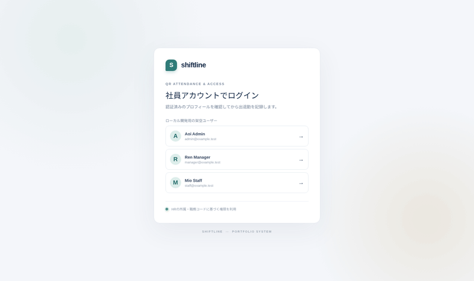
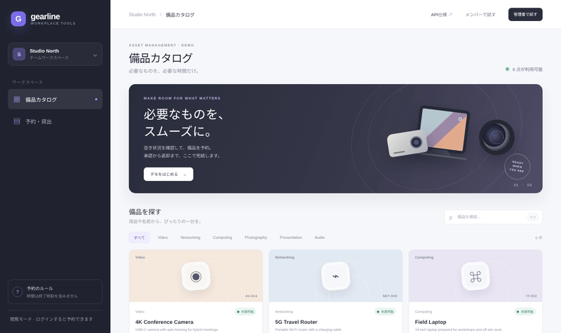
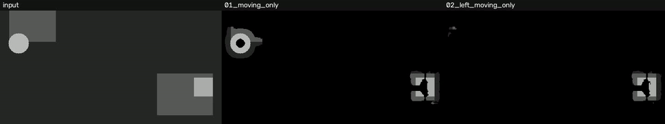

# Portfolio | 藤井 周介

個人で作成した技術検証・デモアプリの一覧です。各項目に、目的、主な機能、技術、確認方法をまとめています。ソースコードと実際に操作できる公開ページがある作品は、それぞれのリンクから確認できます。

## 一覧

| プロジェクト | 概要 | 公開状態 | 詳細 |
|---|---|---|---|
| QR勤怠認証システム | QR打刻、HRスナップショット同期、部門権限管理 | Renderで公開・動作確認済み、操作デモGIFあり | [詳細](#qr-attendance-authorization-demo) |
| 備品予約システム | 予約、承認、貸出・返却、競合制御 | Renderで公開・動作確認済み、操作デモGIFあり | [詳細](#equipment-reservation-demo) |
| 携帯キャリア比較ガイド | 条件別の候補整理と実質費用比較 | [公開ページ](https://fujishusuke1215-alt.github.io/mobile-carrier-comparison/) | [詳細](#mobile-carrier-comparison) |
| 四国旅行 Folium 地図 | 四国の訪問候補地を地図に表示 | [公開ページ](https://fujishusuke1215-alt.github.io/shikoku-folium-map/) | [詳細](#shikoku-folium-map) |
| Burnside の pq 定理 | 有限群論・表現論のLaTeX文書 | LaTeXソース・PDFを公開 | [詳細](#burnside-pq-theorem) |
| Dense Optical Flow | Farneback法による動被写体領域の抽出 | Pythonソース・処理結果GIFあり | [詳細](#dense-optical-flow-analysis) |
| Todoist ゴミ出し当番自動化 | GASとTodoist・Googleサービスの連携 | Apps Scriptソースを公開 | [詳細](#todoist-garbage-duty-automation) |

## QR Attendance Authorization Demo

**QR勤怠認証システム（Entra ID対応）** — QRコードによる出退勤、HRデータの同期、部門単位の権限管理をまとめたフルスタックのデモです。社員名、所属、職務コードは架空データです。実企業での稼働や本番導入を示すものではありません。

- 出勤用・退勤用のQRをHMAC-SHA256で個別に発行し、管理者による更新で旧コードを失効
- サーバー側で社員プロフィール、現行QR、Tokyoの勤務日を検証し、`Idempotency-Key` による再送を処理
- HRスナップショットから部門、社員プロフィール、所属、自動権限を同期
- HR由来の権限と手動付与を分離し、手動権限を同期処理で変更しない
- QR更新や手動権限変更を監査ログに記録
- Microsoft Entra ID / MSALと架空ユーザーを使うローカル開発認証をアダプターで切替

**技術:** Rust、Axum、SQLx、PostgreSQL、React、Vite、TypeScript、Microsoft Entra ID / MSAL、Docker Compose、OpenAPI 3.1。

**試す:** リポジトリのルートで `docker compose up --build` を実行し、`http://localhost:5173` を開きます。管理者・マネージャー・社員の架空ユーザーを選んで操作します。実サービスのHRへの接続や、Entra IDの実アカウントでのログインは行いません。

以下はローカル環境で実際に操作した記録です。

**関連資料:** [ソースコード・起動手順](https://github.com/fujishusuke1215-alt/qr-attendance-authorization-demo)、[機能対応表](https://github.com/fujishusuke1215-alt/qr-attendance-authorization-demo/blob/main/docs/FEATURE_MATRIX.md)、[設計判断](https://github.com/fujishusuke1215-alt/qr-attendance-authorization-demo/blob/main/docs/DESIGN.md)、[OpenAPI](https://github.com/fujishusuke1215-alt/qr-attendance-authorization-demo/blob/main/docs/openapi.yaml)。[ライブデモ（Render・ログイン画面）](https://qr-attendance-demo-ui.onrender.com/login)（ブラウザーでログイン後の画面も確認済み）。

## Equipment Reservation Demo

**備品予約システム** — 備品の空き状況確認から予約申請、承認、貸出・返却までを扱うフルスタックのデモです。

- 備品カタログ、詳細、予約済み時間帯の表示
- メンバーによる予約申請と開始前のキャンセル、管理者による承認・却下・貸出・返却
- PostgreSQLの排他制約で同一備品・同一時間帯の重複予約を拒否
- `Idempotency-Key` により再送を同じ予約へ収束
- 状態変更と監査イベントを同一トランザクションで記録
- OpenAPI 3.1のREST APIを提供

**技術:** Rust、Axum、SQLx、PostgreSQL、React、Vite、TypeScript、Docker Compose。

**試す:** リポジトリのルートで `docker compose up --build` を実行し、`http://localhost:8080` を開きます。ローカル用のメンバーまたは管理者デモログインを選びます。

以下はローカル環境で実際に操作した記録です。

**関連資料:** [ソースコード・起動手順](https://github.com/fujishusuke1215-alt/equipment-reservation-demo)、[OpenAPI](https://github.com/fujishusuke1215-alt/equipment-reservation-demo/blob/main/openapi.yaml)、[予約整合性の設計判断](https://github.com/fujishusuke1215-alt/equipment-reservation-demo/blob/main/docs/adr/0001-reservation-integrity.md)、[認証と状態遷移の設計判断](https://github.com/fujishusuke1215-alt/equipment-reservation-demo/blob/main/docs/adr/0002-demo-auth-and-lifecycle.md)。[ライブデモ（Render）](https://equipment-reservation-demo-ui.onrender.com/)（ブラウザーで動作確認済み）。

## Mobile Carrier Comparison

**携帯キャリア比較ガイド** — 月額料金だけでなく、データ容量、サポート、海外利用、セット割、キャンペーンなどを考慮して候補を整理する静的Webページです。

- 利用データ量、優先事項、現在の回線系列に応じた候補表示
- 2候補の12か月・24か月の実質費用比較
- 乗り換え手順のチェックリスト。状態はブラウザー内の`localStorage`に保存
- 各通信事業者の公式ページへの参照リンク

**技術:** HTML、CSS、JavaScript、Web Storage API。

**公開ページ:** [比較ガイドを開く](https://fujishusuke1215-alt.github.io/mobile-carrier-comparison/)。追加インストールなしで操作できます。

**注意:** 料金・容量・キャンペーンの掲載内容は2026年8月5日時点のスナップショットです。契約前に通信事業者の公式サイトで最新条件を確認してください。詳細は[ソースコードとREADME](https://github.com/fujishusuke1215-alt/mobile-carrier-comparison)を参照してください。

## Shikoku Folium Map

**四国旅行 Folium 地図** — 旅行候補地の位置関係を確認するインタラクティブ地図です。

- 空港、観光地、飲食店など14地点をマーカーで表示
- マーカー上に地点名を表示
- PythonスクリプトからLeafletベースのHTML地図を生成

**技術:** Python、Folium、Leaflet、OpenStreetMap、HTML。

**公開ページ:** [四国の地図を開く](https://fujishusuke1215-alt.github.io/shikoku-folium-map/)。地図タイルなどの表示にインターネット接続が必要です。地点は固定データで、経路検索や移動時間計算は行いません。

**関連資料:** [ソースコードとREADME](https://github.com/fujishusuke1215-alt/shikoku-folium-map)、[地図生成スクリプト](https://github.com/fujishusuke1215-alt/shikoku-folium-map/blob/main/shikoku_trip_map.py)、[生成済みHTML](https://github.com/fujishusuke1215-alt/shikoku-folium-map/blob/main/shikoku_trip_map.html)。

## Burnside pq-Theorem

**Burnside の \((p^a q^b)\)-定理**に関する数学文書です。群論の基礎から複素表現、指標、代数的整数、円分体へ進み、定理を扱います。

- 有限群、準同型、部分群、商群
- 複素表現と既約表現、指標と類関数
- 代数的整数、1の冪根、円分体
- LaTeXの`amsart`文書として構成

**技術・分野:** LaTeX、AMS数学パッケージ、有限群論、表現論、指標論。

**文書ソース:** [main.tex](https://github.com/fujishusuke1215-alt/burnside-pq-theorem/blob/main/main.tex)。コンパイルには`pdflatex main.tex`を複数回実行します。参考文献と公開用の整理範囲は[README](https://github.com/fujishusuke1215-alt/burnside-pq-theorem)および[REWRITE_REPORT.md](https://github.com/fujishusuke1215-alt/burnside-pq-theorem/blob/main/REWRITE_REPORT.md)にあります。[コンパイル済みPDF（61ページ）を見る](./assets/burnside_pq_theorem.pdf)。

## Dense Optical Flow Analysis

**Dense Optical Flow（OpenCV）** — Farneback法の密なオプティカルフローを使い、動画中の動被写体領域を抽出するPython課題です。

- `src/01_moving_only.py`: 速度ベクトルの大きさで動きを判定し、静止領域を黒く表示
- `src/02_moving_and_left.py`: 動きに加えて、左方向へ移動する領域を抽出
- 連続フレームをグレースケール化し、Farneback法でベクトルを計算して結果を表示

**技術:** Python、OpenCV、NumPy、Farneback Dense Optical Flow。

**実行方法:** `pip install -r requirements.txt` の後、権利と配布条件を確認した解析対象動画をリポジトリ直下に置き、`python src/01_moving_only.py` または `python src/02_moving_and_left.py` を実行します。終了は`q`または`Esc`です。

**関連資料:** [ソースコードとREADME](https://github.com/fujishusuke1215-alt/dense-optical-flow-opencv)、[動領域の抽出コード](https://github.com/fujishusuke1215-alt/dense-optical-flow-opencv/blob/main/src/01_moving_only.py)、[左向き動領域の抽出コード](https://github.com/fujishusuke1215-alt/dense-optical-flow-opencv/blob/main/src/02_moving_and_left.py)。

## Todoist Garbage Duty Automation

**Todoist ゴミ出し当番自動化** — Google Apps ScriptとTodoist REST APIで収集予定と2人分の当番を扱うサンプルです。Google Spreadsheetに予定・実績・通知履歴を記録し、Google CalendarとTodoistへ反映します。

- 収集日、実績、通知ログ、集計シートの初期作成
- 「まとめる」「外に出す」の担当割り当て、Todoistタスク作成と通知
- Todoistの完了履歴を使った実績同期と、Google Calendarへの終日イベント登録
- 前夜・当日朝の時間トリガー、通知ログによる重複抑制

**技術:** Google Apps Script、Todoist REST API、Google Spreadsheet、Google Calendar、Script Properties。

**ソース・手順:** [スクリプトとREADME](https://github.com/fujishusuke1215-alt/todoist-garbage-duty-automation)。利用には利用者自身のGoogle/Todoist設定が必要です。APIトークンはスクリプトプロパティに保管し、ソースコードには記載しません。README記載の収集日サンプルは川口市の2026年通常日程を参考にしたもので、実際に使用する地域・年度の公式情報を確認してください。

## 表示内容について

このページの技術・機能・実行条件は、各ソースリポジトリのREADMEと公開ファイルに基づいています。QR勤怠認証と備品予約のデータはデモ用です。料金・収集日など時期や地域で変わる情報は、利用前に各公式情報を確認してください。